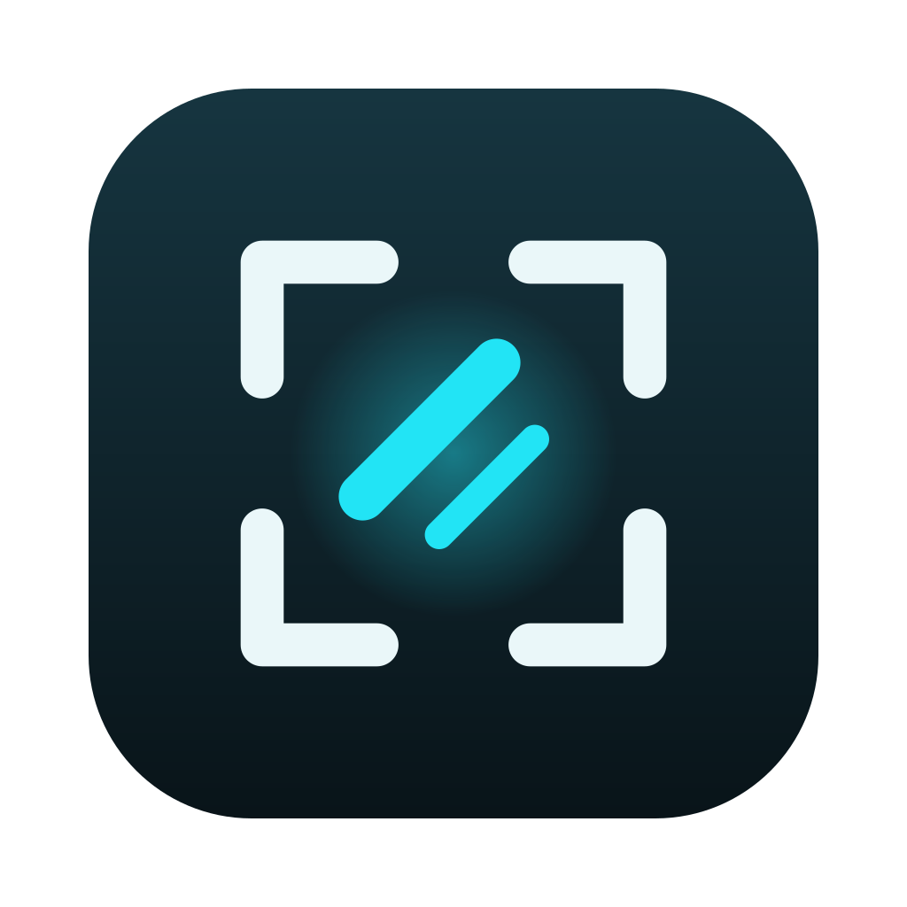

<p align="center">
  
</p>

<h1 align="center">Glint</h1>

<p align="center">
  Screenshots, annotation and screen recording for macOS.<br>
  Native, free and fully local.
</p>

<p align="center">
  <a href="#build">Build</a> · <a href="CONTRIBUTING.md">Contributing</a> · <a href="LICENSE">License</a>
</p>

## Features

**Capture**
- Area, window, full screen, previous area, timer and all-in-one
- Scrolling capture, vertical and horizontal
- Frozen selection, magnifier, exact sizes and aspect ratios
- Text and QR recognition on device

**Annotate**
- Arrows, shapes, pen, text, counters, highlight, spotlight
- Blur, pixelate and solid redaction
- Crop, resize, rotate, flip, canvas size, backgrounds and presets
- Editable `.glint` projects

**Record**
- System audio, microphone, camera, clicks and optional keystrokes
- Editable `.glintvideo` projects: trim, cut, cursor zoom, backgrounds, camera and cursor effects after recording
- MP4, GIF and lossless trim export

**Everything else**
- Quick access popup, history, pins and drag to any app
- Configurable shortcuts and `glint://` automation

Projects keep the original pixels under redactions. Share exported images, not project files.

## Shortcuts

| Shortcut | Action |
|---|---|
| `⌃⌥4` | Capture area |
| `⌃⌥3` | Capture screen |
| `⌃⌥5` | Record / stop |
| `⌃⌥T` | Capture text |
| `⌃⌥H` | History |

## Build

Requires macOS 27 and Xcode 27.

```sh
scripts/build-app.sh
open build/Glint.app
```

Run tests with `swift test`.

<details>
<summary>Automation</summary>

Turn on **Allow capture URLs** in Settings, then open:

```text
glint://capture?mode=area|window|fullScreen|previousArea|scrolling|text|allInOne
glint://record
glint://stop
glint://history
```

</details>

## Permissions

Screen Recording is required. Microphone, camera and Accessibility are requested only when a feature needs them.

## License

[GPLv3](LICENSE)
