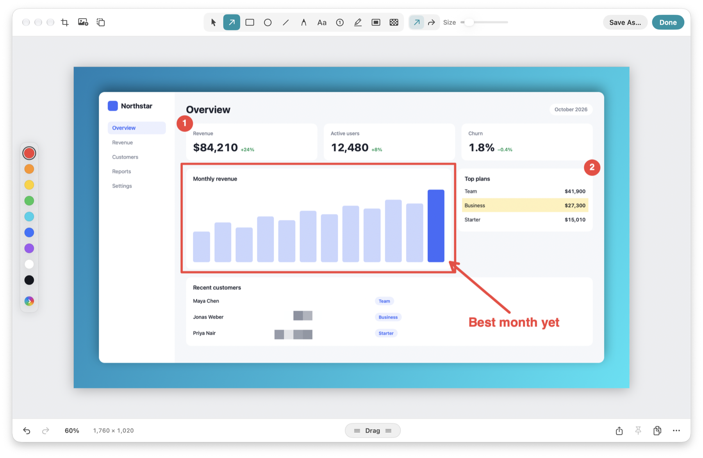
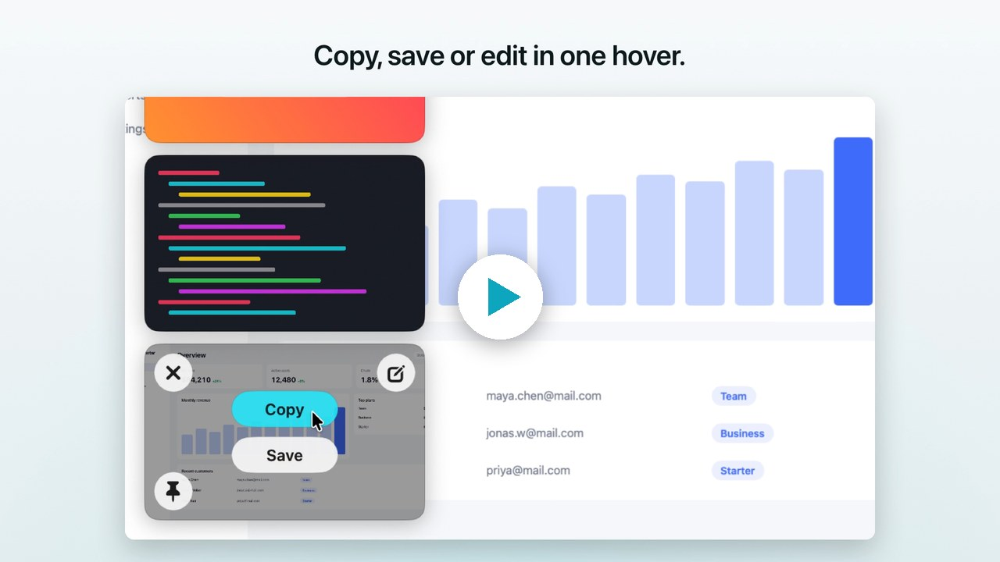
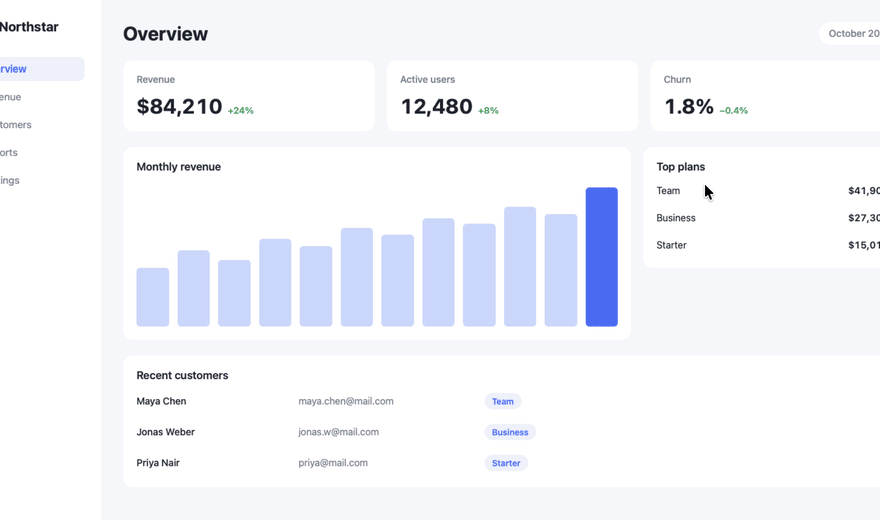
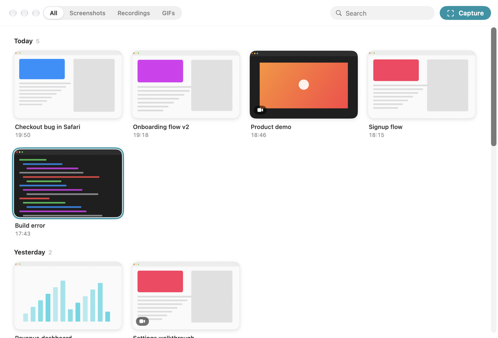
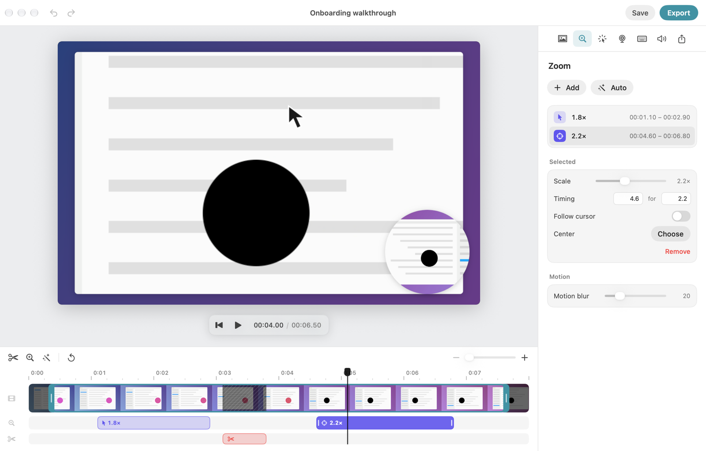
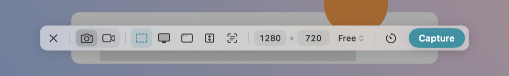
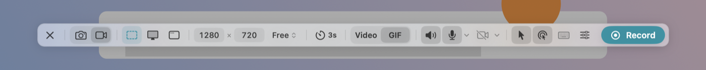
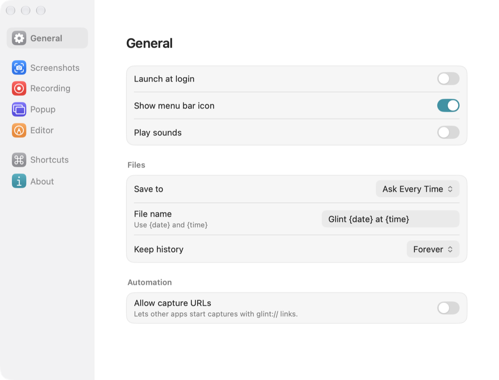

<p align="center">
  
</p>

<h1 align="center">Glint</h1>

<p align="center">
  Screenshots, annotation and screen recording for macOS.<br>
  Free, open source and fully local.
</p>

<p align="center">
  <a href="https://github.com/Ammaar-Alam/Glint/releases/latest">Download</a> · <a href="#features">Features</a> · <a href="CONTRIBUTING.md">Contributing</a> · <a href="LICENSE">License</a>
</p>

<p align="center">
  
</p>

<p align="center">
  <a href="assets/readme/launch.mp4"></a>
</p>

## Capture, then keep going

Press <kbd>⇧⌘4</kbd> and your capture lands in the corner. Hover to copy, save, pin or edit, or drag it straight into any app.

<p align="center">
  
</p>

## Features

**Capture**
- Area, window, full screen, previous area, scrolling and text, all from one bar on <kbd>⇧⌘5</kbd>
- Exact sizes, aspect ratios, timer, frozen screen and a real-time magnifier
- Text and QR recognition on device

**Annotate**
- Arrows, shapes, pen, text, counters, highlight and spotlight
- Redact with blur, pixelate or a solid cover
- Generated gradient backgrounds, padding, corners and shadow in one click
- Crop, resize, rotate, flip and canvas size, with editable `.glint` projects

**Record**
- Video or GIF with system audio, microphone, camera, clicks and keystrokes
- Edit after recording: trim, cut, cursor-following zooms, backgrounds and camera layout
- MP4, GIF and lossless trim export

**Keep everything**
- A searchable history of screenshots, recordings and GIFs
- Automatic saves to any folder in PNG, JPEG or HEIC
- Pins, drag to any app, configurable shortcuts and `glint://` automation

<table>
  <tr>
    <td></td>
    <td></td>
  </tr>
  <tr>
    <td><br></td>
    <td></td>
  </tr>
</table>

Projects keep the original pixels under redactions. Share exported images, not project files.

## Install

Download the DMG from [Releases](https://github.com/Ammaar-Alam/Glint/releases/latest) and drag Glint to Applications. Requires macOS 26 or later.

Glint walks you through Screen Recording access on first launch. To use the screenshot keys, turn off **Screenshots** in System Settings → Keyboard → Keyboard Shortcuts.

## Shortcuts

| Shortcut | Action |
|---|---|
| <kbd>⇧⌘5</kbd> | All-in-one capture |
| <kbd>⇧⌘4</kbd> | Capture area |
| <kbd>⇧⌘3</kbd> | Capture screen |
| <kbd>⇧⌘2</kbd> | Capture text |
| <kbd>⇧⌘6</kbd> | Record / stop |

All shortcuts can be changed in Settings.

## Build

Requires macOS 26 or later and Xcode 26 or later.

```sh
scripts/build-app.sh
open build/Glint.app
```

Run tests with `swift test`.

<details>
<summary>Automation</summary>

Turn on **Allow capture URLs** in Settings, then open:

```text
glint://capture?mode=area|window|fullScreen|previousArea|scrolling|text|allInOne
glint://record
glint://stop
glint://history
```

</details>

## License

[GPLv3](LICENSE)
